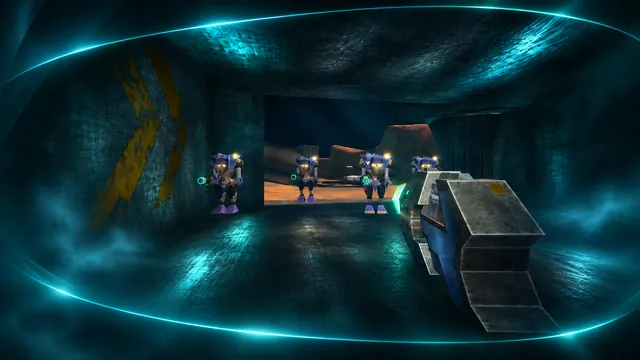

# aly95.github.io

Personal portfolio site for Aly Huggan. Plain HTML, CSS and a little JavaScript on GitHub Pages, with no build step.
To preview, run `python3 -m http.server` in this folder and open http://localhost:8000.

## Files

- `index.html`: the whole page. All visible copy is here. Look for `<!-- COPY: ... -->` comments to find each section, and `<!-- PLACEHOLDER: ... -->` for details still to fill in.
- `style.css`: one stylesheet. Colours, type and spacing are custom properties at the top.
- `site.js`: enhancements only. The page reads and works without it. One function per feature:
  - `boot`: ends the start-up animation (played by CSS on the first visit in a session) and remembers that it ran.
  - `hud`: makes the top bar solid once the hero has scrolled away, and marks the current section in the nav.
  - `reveal`: fades each block in once as it scrolls into view.
  - `saves`: turns the project list into an accordion (list plus detail on wide screens), with deep links like `/#save-fora`.
  - `gallery` and `lightbox`: thumbnail switching and a full-screen image viewer.
  - `kit`: passes the pointer position to the hero's Quest 3 headset and controllers so they shift slightly on wide screens. The drawing itself is inline SVG in `index.html` and needs no script.
  - `fx`: the FX toggle, which turns off scanlines and decorative motion and remembers the choice.
  - `contact`: arrow keys between the contact links, and the Copy button for the email.
  - `year`: the year in the footer.
- `tools/quest3.py`: not part of the site. It draws the hero's headset and controllers from a small 3D model and prints the four `<svg>` elements inside `<div class="q3">` in `index.html`. To change the drawing, edit the script, run `python3 tools/quest3.py` (needs NumPy and Shapely) and paste the output over those elements. The paths in `index.html` are the script's output with no hand edits. Colours and line weights are the `.q` rules in `style.css`.
- `404.html`: the not-found page.
- `project45.html`, `fora.html`, `covid.html`: redirects from the old project pages.
- `fonts/`: Inter, Chakra Petch and Silkscreen, self-hosted under the SIL Open Font License (`fonts/OFL.txt`).
- `img/{project}/`: screenshots and photos, one folder per project.

## Adding photos to a project (VR captures and similar)

Metal Arms in VR and Digimon World now have one capture each (Metal Arms in a wide gallery, Digimon World in a phone frame because the capture is portrait). Adding more needs no CSS or JavaScript changes.

1. **Check each photo first.** Do not use a photo that shows a person, a face, a room at home, a screen with account names, or anything that identifies a location. In-headset captures and screen captures are fine.
2. **Export as WebP, quality 80, with metadata stripped**, at three widths: 640, 1280 and 1920 px. If the source is narrower than 1920 px, save it at its own width but still name it `-1920` (never upscale). Aim for at most 220 KB at 1280 px and 420 KB for the largest. For example, with Pillow:

   ```python
   from PIL import Image
   im = Image.open("capture.png").convert("RGB")
   for w in (640, 1280, 1920):
       w2 = min(w, im.width)
       im.resize((w2, round(im.height * w2 / im.width)), Image.LANCZOS).save(f"metal-arms-01-{w}.webp", quality=80)
   ```

3. **Name and place them** as `img/{project}/{project}-{nn}-{width}.webp`, for example `img/metal-arms/metal-arms-01-1280.webp`. Put the strongest image first. At most 8 images per project.
4. **Paste this block** into the project's `.save-body` in `index.html`, after `.save-big` and before the `.d` summary (the Metal Arms panel has a working example). Use one `<li>` per image, set `width` and `height` on the stage image and `data-w`/`data-h` on each thumbnail to the image's real 1280 px size, and write a one-sentence `alt` for each that says what is on screen. Captions are optional and should only describe what is visible (90 characters at most).

   ```html
   <div class="gallery wide" data-title="Metal Arms in VR">
   <a class="stage" href="img/metal-arms/metal-arms-01-1920.webp">
   
   <span class="stage-hud" aria-hidden="true"><span>Capture <b>01</b> / 02</span><span><svg class="icon" viewBox="0 0 12 12" shape-rendering="crispEdges" fill="currentColor" aria-hidden="true"><path d="M1 1h4v2h-2v2h-2zM7 1h4v4h-2v-2h-2zM1 7h2v2h2v2h-4zM9 7h2v4h-4v-2h2z"/></svg> View</span></span>
   </a>
   <ol class="thumbs">
   <li><a href="img/metal-arms/metal-arms-01-1920.webp" data-base="img/metal-arms/metal-arms-01" data-w="1280" data-h="720" data-caption="" aria-current="true"></a></li>
   <li><a href="img/metal-arms/metal-arms-02-1920.webp" data-base="img/metal-arms/metal-arms-02" data-w="1280" data-h="720" data-caption=""></a></li>
   </ol>
   <p class="caption"></p>
   </div>
   ```

   - Update the `/ 02` total in the stage label to the number of images.
   - With a single image, keep only the `<a class="stage">` part and the empty caption, and drop the `<ol class="thumbs">` list and the counter.
   - The stage crops to 16:9, 4:3 or square depending on the first image's shape. The lightbox always shows the whole image.

For a new project, copy an existing `.save` block, give it a new `id` (`save-...`), a title, a status and a 12×12 pixel icon in the same style, and the counters on the page update themselves.
